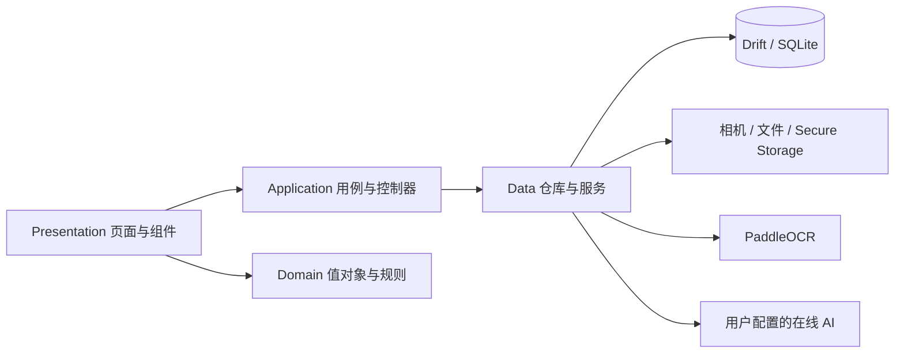
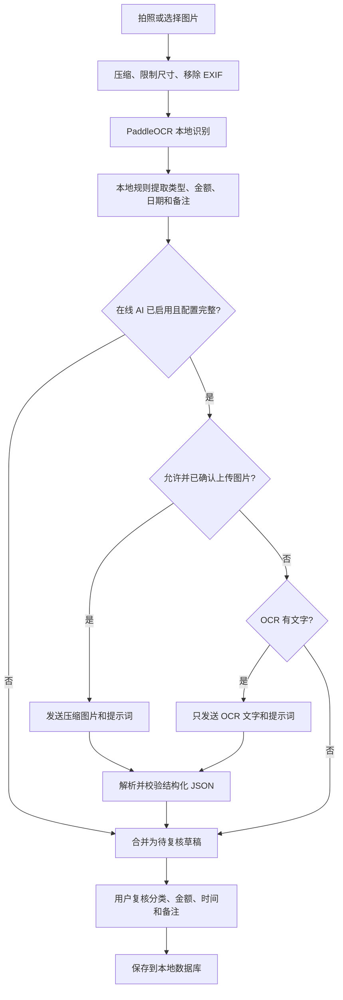

# 安安记账（AnBookkeep）

安安记账是一款面向 Android 的本地优先移动记账应用。项目强调简洁留白、快速录入、明确的数据边界，以及离线可用的账单管理体验。

当前版本：`1.0.0+1`  
应用标识：`com.an.anbookkeep`  
首发平台：Android 8.0（API 26）及以上、`arm64-v8a`

> 账单与分类默认保存在设备本地。只有用户启用在线 AI 后，OCR 文字才可能发送到用户配置的服务；只有另外开启图片上传并确认授权后，压缩后的账单图片才会发送到该服务。

## 功能

### 明细

- 应用首页，默认定位到最近有账单的月份；没有任何账单时显示当前年月。
- 数据按年加载并拆分为月份、日期分组，账单按日期时间倒序显示。
- 向上或向下滚动时按需加载相邻的有数据年份。
- 可通过年月滚轮跳转到指定月份；无数据月份只提示，不改变当前位置。
- 顶部汇总当前可见月份的收入、支出和结余。
- 左滑账单并二次确认后删除，点击账单进入编辑。
- 右下角圆形记账按钮支持普通记账；长按 200 ms 展开拍照记账和图片记账。

### 记账

- 支出、收入切换及对应分类单选。
- 单行备注和最多 20 条历史备注快捷回填。
- 历史备注支持按频率排序或结合分类、金额、时间和近期使用情况智能评分。
- 日期、分钟两档展示精度；数据库始终保存到分钟。
- Decimal 计算器支持加、减、乘、除、小数、退格和长按快速退格。
- 没有运算式或计算完成时，等号键自动切换为保存。
- 支持新增和编辑账单，金额允许 `0.00`，单笔上限为 `999,999,999.99`。

### 分析

- 支出、收入、结余三个统计维度。
- 月、年、全部三个时间范围。
- 总金额、平均值和总笔数汇总。
- 月范围按自然日计算日均，年范围固定除以 12，全部范围按实际有账单的年份数计算年均。
- 趋势支持平滑折线图和柱状图，包含平均值虚线。
- X 轴最多显示 12 个标签，Y 轴最多显示 6 个标签。
- 分类支持环形图和进度条列表；环形图分类过多时合并为“前 9 项 + 其他”。

### 搜索

- 进入页面后按明细相同的年度规则加载账单。
- 支持备注关键词、收支类型、日期范围、分类和金额范围组合筛选。
- 输入关键词或金额后自动防抖刷新。
- 选择全部收支时查询全部分类；选择收入或支出后显示对应分类多选。
- 搜索结果复用明细页面的日期分组和账单组件。

### 分类和设置

- 跟随系统、亮色、暗色三种外观模式。
- 自定义主题色、收入色和支出色，支持圆形调色板与 HEX 输入。
- 默认主题色 `#26AAFF`、收入色 `#FF1122`、支出色 `#11CD22`。
- 金额支持 `123,456.78` 和 `123456.78` 两种格式。
- 分类以四列网格管理，支持长按拖拽排序。
- 分类名称、内置图标和颜色可编辑；新增分类随机生成鲜亮颜色。
- 已被账单使用的分类允许编辑但禁止删除，历史账单会同步显示最新分类信息。

### 图片与 AI 记账

- PaddleOCR 本地文字识别，可在不开启在线 AI 的情况下使用。
- 可选接入 OpenAI Chat Completions 兼容的 HTTPS 接口。
- 文本模型、视觉模型、API 地址和 API Key 由用户配置。
- API Key 使用 Flutter Secure Storage 保存。
- 支持自定义提示词、复制提示词和切换当前提示词。
- 支持拍照识别、单图识别和最多 20 张图片的批量识别。
- 支持从 Android 相册、截图及其他应用将单张或多张图片分享到安安记账，并复用相同的识别与复核流程。
- 批量结果支持图片预览、重新识别、左滑删除、逐条编辑和一次性保存。
- 图片在识别前压缩并移除 EXIF；临时图片在流程结束或过期后清理。
- 在线 AI 不可用时回退到本地 OCR 结果，并提示用户复核。

### 数据管理

- 导出 XLSX 或 CSV，默认 XLSX。
- 导出字段固定为类型、分类、时间、金额、备注。
- 导出时间格式跟随全局记账时间精度。
- 导入 XLSX 或 CSV，可在前 10 行识别表头并手动调整字段映射。
- 日期没有时间时按当天 `00:00` 保存。
- 未找到的分类自动创建，使用内置“其他”图标和随机鲜亮颜色。
- 当前版本不自动去重，提交前会展示有效、无效和新建分类数量。
- 单个导入文件上限 50 MB、最多 100,000 行。
- CSV 导出会中和可能触发电子表格公式的文本。
- 局域网备份复用 XLSX 导出，通过加密连接将文件保存到电脑。启用后，账单变更合并为一次自动备份，也可手动备份。

### 局域网备份

1. 用 JDK 21 执行 `mvn -f backup-receiver/pom.xml package`。运行 `java -jar backup-receiver/target/anbookkeep-backup.jar` 启动电脑端。
2. 首次启动会在 JAR 同目录生成 `config.properties`。终端会显示可用的 IP 和端口、完整的 Key 和备份路径。将终端显示的 Key 填到手机的「设置 → 数据管理 → 局域网备份」，再填写文件名主体并打开「开启备份」。例如输入 `AN`，电脑保存为 `AN.xlsx`。
3. 「直连地址」留空时自动搜索电脑。跨网段时可填写终端显示的地址，例如 `192.168.1.10:18765`。手机必须能够访问电脑的 TCP 18765 端口。自动搜索还需要局域网传递 mDNS（UDP 5353）。

账单有变更时，App 会在 Wi‑Fi 或有线网络上立即尝试备份。一次只上传一个文件，上传期间的多笔修改合并到下一次。App 启动或从后台切回时会检查未备份的版本，有待备份的变更就立即尝试上传。也可在设置页点「立即备份」。

每次备份通过一次 HTTPS 请求发送 XLSX。手机用完整 Key 包含的公钥指纹确认电脑身份，电脑校验请求头里的备份 Key 后才保存文件。

默认目录为 JAR 旁的 `backups`。可修改 `backup.path` 为相对路径或 Windows 绝对路径，再重启接收器。修改 `key` 后，重启并将终端显示的新 Key 填到手机。

## 技术栈

| 领域 | 方案 | 用途 |
| --- | --- | --- |
| 客户端 | Flutter 3.47 / Dart 3.13 | Android UI 与业务实现 |
| 状态与依赖 | Riverpod 3 | 设置状态、异步配置、依赖注入 |
| 导航 | go_router | 集中式路由和编辑参数传递 |
| 数据库 | Drift + SQLite | 本地账单、分类、索引与事务 |
| 金额 | Decimal + SQLite INTEGER | 业务层精确十进制、存储层整数分 |
| 图表 | fl_chart | 趋势图、柱状图与环形图 |
| 本地 OCR | PaddleOCR + ONNX Runtime | 设备端图片文字识别 |
| 在线 AI | Dio | OpenAI 兼容 HTTPS 请求 |
| 密钥 | flutter_secure_storage | API Key 安全存储 |
| 设置 | shared_preferences | 外观和非敏感配置持久化 |
| 文件 | excel_plus、csv、file_picker | XLSX/CSV 导入导出 |
| 图片 | image_picker、flutter_image_compress | 拍照、相册选择和预处理 |

## 架构

项目采用按功能分区、功能内分层的结构：

```text
lib/
├─ app/
│  ├─ router/              # 路由表和页面参数
│  └─ theme/               # 主题、颜色、间距、圆角、尺寸和动画令牌
├─ core/
│  ├─ collections/         # 通用集合算法
│  ├─ database/            # Drift 表、数据库与 Provider
│  ├─ datetime/            # 本地分钟值对象与全局日期范围策略
│  ├─ errors/              # 面向用户的安全错误转换
│  ├─ logging/             # 统一日志与敏感字段脱敏
│  ├─ money/               # Money 值对象和格式化
│  ├─ settings/            # 全局设置状态和持久化
│  └─ widgets/             # 卡片、弹窗、底部面板、分段控件等
└─ features/
   ├─ analytics/           # 统计查询、汇总规则和图表页面
   ├─ bookkeeping/         # 账单仓库、计算器、年度加载和录入 UI
   ├─ data_transfer/       # 文件编解码、预览、导入和导出
   ├─ detail/              # 首页明细与快捷记账入口
   ├─ search/              # 搜索条件、年度查询和搜索 UI
   ├─ settings/            # 设置和分类管理
   └─ smart_bookkeeping/   # OCR、AI、提示词和批量识别
```

依赖方向：



页面不直接拼接 SQL。账单和分析查询集中在 Repository；计算器、金额、日期和统计口径尽量保持为可独立测试的纯逻辑。

## 核心数据设计

### 金额

- `Money` 在业务层封装 `Decimal`。
- 数据库使用整数分 `amount_minor`，避免二进制浮点误差。
- 金额符号不与人民币符号同时显示，列表使用 `+`、`-` 表示收支。
- 收支类型和金额绝对值分开保存，不使用负数金额表达支出。

### 时间

- 使用 `LocalMinute` 统一表示 `yyyy-MM-dd HH:mm`。
- “日期/分钟”设置只影响展示和导出格式，不改变数据库结构。
- 日期精度新增账单时，选择的日期会结合保存时的当前时分。
- 日期精度编辑账单时保留原有时分。

### 分类

- 分类只能属于收入或支出之一。
- 账单通过外键引用分类，外键删除策略为 `RESTRICT`。
- 修改分类会自然影响所有历史账单的展示。
- 同一收支类型下分类名称唯一。

### 数据库

- 当前 schema 版本为 1。
- 主要索引覆盖账单时间、收支类型与时间、分类和金额。
- SQLite 外键在数据库打开时显式启用。
- Android 自动备份已关闭；卸载应用会删除本地数据，卸载或换机前应先导出账单。
- 当前数据库未做应用层加密，安全边界依赖 Android 应用沙箱和设备加密；API Key 单独保存在系统安全存储中。

项目尚未发布，因此 schema 1 不包含历史兼容代码。首次发布后，任何 schema 变更必须增加显式迁移和迁移测试，禁止直接修改旧表定义后提升版本号。

## 年度加载设计

明细和搜索共享 `LedgerYearPagingController` 与 `BookkeepingRecordList`：

1. 查询满足条件的最新账单月份。
2. 一次读取该月份所在年份的数据。
3. 在内存中按月、按日拆分，只构建可见列表项。
4. 用户接近顶部或底部时，查询并加载相邻的有数据年份。
5. 明细页根据第一个可见日期组联动顶部月份汇总。
6. 日期跳转会创建新的加载控制器，避免旧异步请求污染新位置。

搜索在相同加载模型上附加关键词、收支、日期、分类和金额条件。

## 图片识别流程



AI 返回的类型、金额、分类 ID、时间和置信度都会再次校验。服务地址必须使用 HTTPS，不能包含凭据、查询参数或片段；客户端不跟随重定向，并限制异常响应大小。

## 设计系统

视觉方向为简洁留白、温和、轻量、圆角但不卡通。

- 亮色页面和卡片背景固定为 `#FFFFFF`。
- 暗色页面和卡片背景固定为 `#000000`。
- 首页及分析汇总卡片使用跟随主题色的柔和左上到右下光感渐变。
- 卡片不使用实体描边，以浅灰层次、背景和轻阴影区分。
- 统一间距基准为 4、8、12、16、24、32。
- 圆角主尺度为 4、8、12、16、20。按钮和输入框使用 16，分段选中项根据外圆角减去实际内缩量得到内圆角。
- 常用字号与行高组合有 12/16、14/20、16/24、20/28。金额使用等宽数字，列表金额右对齐，汇总金额使用更高字重。
- 填充主色上的文字和图标按 Flutter 的明暗判定选择颜色。深色底配白色，浅色底配黑色。
- 标准控件高度 48，分段控件和图标按钮 40，计算器按钮 58。
- 选中的 Tab 和分段项使用完整圆角卡片包裹，未选中项无独立卡片。
- 顶栏图标按钮保持透明背景。
- `TextButton` 用于轻量文字动作；`OutlinedButton` 用于取消等次要动作；`FilledButton` 用于保存、确认等主要动作。
- 所有破坏性操作使用统一错误色并二次确认。
- 常规动画使用 120 ms 或 180 ms；快捷记账展开动画为 360 ms。

设计令牌位于：

- `lib/app/theme/app_theme.dart`
- `lib/app/theme/app_spacing.dart`
- `lib/app/theme/app_tokens.dart`

新增 UI 时应优先复用令牌和 `core/widgets`，避免直接写入新的间距、圆角、颜色和控件高度。

## 编码规范

- 文件名使用 `snake_case.dart`，类型使用 `UpperCamelCase`，成员使用 `lowerCamelCase`。
- Feature 内按 `domain`、`data`、`application`、`presentation` 分层；简单功能可省略不需要的层。
- 金额计算禁止使用 `double` 作为业务真值。
- 数据库存储时间必须通过 `LocalMinute` 创建和校验。
- 页面不得直接显示未知异常的 `toString()`；使用 `appErrorMessage` 给出安全文案，详细异常写入 `AppLogger`。
- OCR 原文、完整提示词和 AI 原始响应只允许通过 `sensitiveDebug` 在 Debug 模式记录。
- 异步页面操作在 `await` 后访问 `context` 或 `setState` 前检查 `mounted`。
- 长任务必须防止重复提交，并处理取消、页面退出和过期结果。
- 修改 Drift 表后运行代码生成并增加数据库迁移测试。
- 提交前执行格式化、静态分析和全量测试。

## 本地开发

### 环境

- Flutter 3.47.2 Stable（版本声明见 `.fvmrc`）
- Dart 3.13.x
- Android Studio / Android SDK 36
- Android SDK Command-line Tools
- JDK 17 或更高版本

项目可使用仓库下的 `.tooling/flutter`，该目录不会提交到版本库。

### 安装依赖

```powershell
.tooling\flutter\bin\flutter.bat pub get
```

### Drift 代码生成

修改数据库表或查询注解后执行：

```powershell
.tooling\flutter\bin\dart.bat run build_runner build
```

### 质量检查

```powershell
.tooling\flutter\bin\cache\dart-sdk\bin\dart.exe format --output=none --set-exit-if-changed lib test
.tooling\flutter\bin\flutter.bat analyze --no-pub
.tooling\flutter\bin\flutter.bat test --coverage --no-pub
```

## Android 构建与签名

复制签名模板：

```powershell
Copy-Item android\key.properties.example android\key.properties
```

填写发布密钥的绝对路径、密码和别名。`key.properties`、JKS 和 Keystore 已加入忽略规则，不得提交、上传或写入日志。

构建 APK：

```powershell
.tooling\flutter\bin\flutter.bat build apk --release --target-platform android-arm64 --no-pub
```

构建 Google Play AAB：

```powershell
.tooling\flutter\bin\flutter.bat build appbundle --release --no-pub
```

Release 构建缺少签名时会主动失败。正式上传前还应检查：

- `flutter doctor -v` 的 Android 工具链和 License 状态。
- 版本名、版本号和 `com.an.anbookkeep` 应用标识。
- AAB 签名证书指纹。
- API 36 目标版本。
- 16 KB ZIP/ELF 对齐。
- arm64 真机上的 PaddleOCR、拍照和批量图片识别。
- Google Play Data Safety、隐私政策和截图资料。

## 测试策略

当前测试覆盖：

- Money 舍入、范围和格式化。
- LocalMinute 日期有效性。
- 全局日期范围、实际数据年份自动扩展和 Drift schema 基线。
- 计算器优先级、精确运算和异常。
- 数据库约束、分类和账单仓库。
- 年度加载、相邻年份和并发去重。
- 搜索条件、防抖输入和共享账单列表。
- 分析汇总、趋势图和分类图关键样式。
- 历史备注普通排序和智能评分。
- 分类编辑、图标和颜色设置。
- CSV/XLSX 表头识别、字段映射、导入导出以及异常压缩包边界。
- AI 配置、响应解析、HTTPS 限制、重定向、请求边界和取消上下文。
- 快捷 AI 记账按钮动画。

发版前仍需在真实 Android 设备上完成原生集成测试。Widget 测试不能替代相机、文件选择器、Secure Storage、PaddleOCR、ONNX Runtime 和系统分享文件界面的真机验证。

## 隐私与安全

- 账单数据库默认只保存在应用私有目录。
- 应用关闭 Android 自动备份，避免数据库进入通用云备份。
- API Key 使用系统安全存储，不写入 SharedPreferences。
- 在线 AI 默认关闭，图片上传默认关闭。
- 开启图片上传时会显示包含数据范围和费用风险的确认提示。
- 图片预处理会移除 EXIF，并在完成、取消或过期后清理临时文件。
- 图片、OCR 文本、AI 提示词、AI 响应和 XLSX 解压内容均有明确大小上限。
- Release 日志不记录 OCR 原文、提示词、AI 原始响应或 API Key。
- 自定义在线 AI 服务由用户选择，服务的数据保留与处理规则由对应服务提供方决定。

## 已知边界

- 当前只发布 Android arm64，不支持 32 位 Android、x86/x64 Android 模拟器和 iOS。
- 当前没有账号和云同步。
- 导入不会自动去重，重复导入会产生重复账单。
- 本地 OCR 与在线 AI 都可能识别错误，保存前必须由用户复核。
- 数据库未做应用层加密。
- PaddleOCR 模型和原生库使安装包体积较大。

## 后续方向

- Android 性能与稳定性持续优化。

## 许可证

项目当前未声明开源许可证，默认保留全部权利。发布或开放源码前应补充适用的许可证文件，并核对第三方依赖的许可证与 NOTICE 内容。
